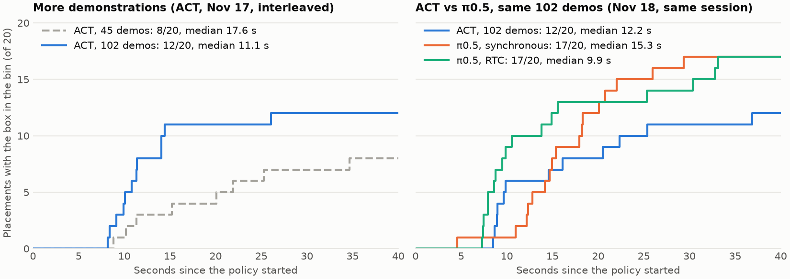
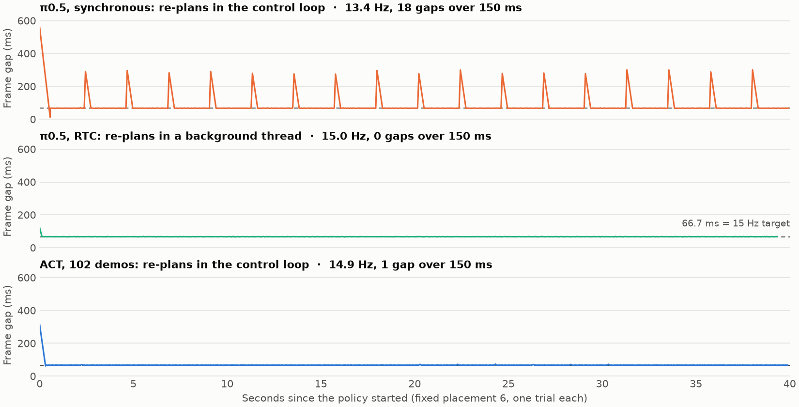
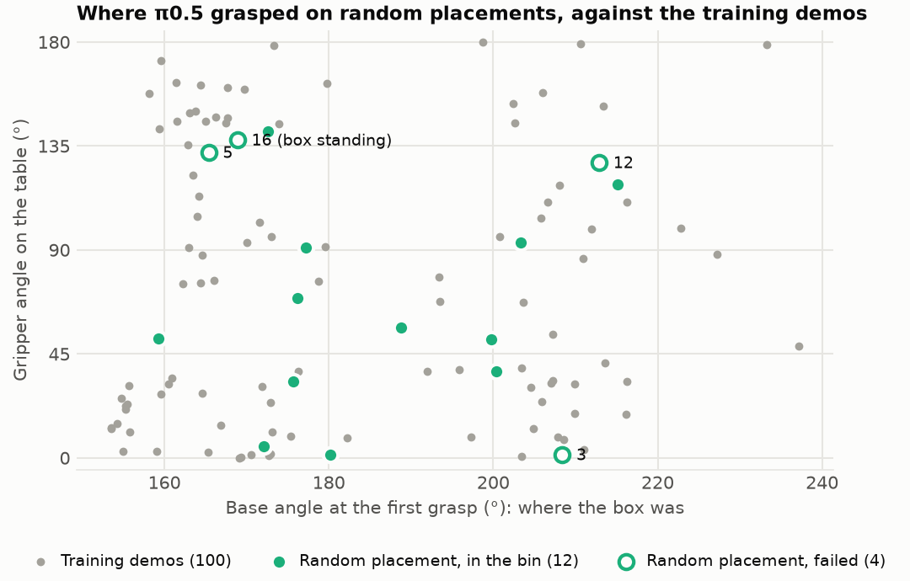

# nexarm-imitation

Imitation learning on a NexArm leader–follower arm: 102 teleoperated
demonstrations of one task ("pick up the medicine box and put it in the bin"),
ACT trained on them, π0.5 (a pretrained vision-language-action model)
LoRA-fine-tuned on the same data on a single 16 GB GPU, and both evaluated on
the real arm under the same conditions.


Fixed placement 19 of the first set: ACT on the left, π0.5 with real-time
chunking (RTC) on the right, 2× speed, clocks in real time. Only π0.5 succeeds
here, and that makes it a favourable example: over both sets of 20 placements,
π0.5 with RTC put the box in the bin 29 times and ACT 24 times, and on the
second set they tied at 13. A 53 s video
([scripts/make_demo.py](scripts/make_demo.py)) adds a placement both policies
solve, random placements, two failures and the first set's results.

**Status:** first round complete: data collection, two policies, three
real-robot evaluation sessions, a random-placement test and a demo video.
Second round: a second set of 20 placements with the two policies
interleaved, a review of every failure, and robustness tests with a card
beside the box and an extra lamp (all done, 2026-11-22). Under way: 48 more
demonstrations aimed at π0.5's grasp, and both policies retrained on all 150.
The project follows
[nexarm-teleop-latency](https://github.com/lfulai223-wq/nexarm-teleop-latency),
which measured and reduced the teleoperation latency of the same arm. See
[what is not done](#limitations). Full write-up: [docs/report.md](docs/report.md).

## Results

Two sets of 20 fixed placements, one 40 s trial per policy and placement, with
the same camera position on both days. On the first set the three policies ran
back to back (2026-11-18); on the second, ACT and π0.5 with RTC took turns
placement by placement (2026-11-22).

| Policy | Set 1: box in the bin within 40 s | Within 25 s | Set 2: within 40 s | Within 25 s | Median time to release, set 1 / set 2 | Control rate, set 1 |
|---|---|---|---|---|---|---|
| ACT, 102 demos | 11/20 | 9/20 | 13/20 | 11/20 | 9.9 s / 12.0 s | 14.9 Hz |
| π0.5, synchronous inference | 17/20 | 15/20 | – | – | 15.3 s | 13.4 Hz |
| π0.5, RTC | 16/20 | 13/20 | 13/20 | 11/20 | 9.7 s / 13.0 s | 15.0 Hz |

Success within 40 s is the operator's call, corrected after a video review:
in four trials the operator had put a dropped box back under the gripper
during the run and the policy then succeeded, and those count as failures
([results/operator_interventions.csv](results/operator_interventions.csv)).
The 25 s column and the release times come from the joint data: the moment the
gripper opens with the base over the bin, ignoring anything after a hand
entered the frame. That rule agreed with the operator's own calls on all 160
fixed-placement trials in this project.

- **No clear winner on success.** On set 1, placement by placement, π0.5
  succeeded where ACT failed 7 times to 1 synchronously (exact sign test,
  p = 0.07) and 6 to 1 with RTC (p = 0.12). On set 2, interleaved, it was 3 to
  3. Both sets together, RTC against ACT: 9 to 4 within 40 s (p = 0.27) and
  8 to 4 within 25 s (p = 0.39). The set-1 gap did not carry over to new
  placements, and 20 pairs cannot say whether that is the placements, the
  interleaving or chance.
- **Horizontal placements.** Most of the set-1 gap was the box lying
  horizontally in the camera image: ACT 2/7, π0.5 7/7 synchronous and 4/7 with
  RTC. On set 2 both managed 3/7, and three of the four placements both failed
  were horizontal.
- **They fail differently.** ACT with 102 demos failed at the grasp in 20 of
  its 24 failures: closing off-centre on the box, or centred without lifting
  it. π0.5 with RTC failed after lifting the box in 7 of 11, and in 7 of 11 it
  had grasped the box by one end. The joint data shows a firm grip:
  commanded minus measured gripper position was at least 10 counts after the
  first close in 72 of 87 grasps that carried the box straight to the bin, and
  in none of the 57 failures where the gripper closed.
- **π0.5 grasps on the move.** In the last second before the gripper first
  closes, the demonstrations have the arm almost still (median joint speed 51
  counts/s, summed over five joints), and ACT is similar (49–77). π0.5 is at
  about 360, synchronous or RTC alike: it closes while the arm is still
  travelling. In its failures it also commands only a partial close (median
  1580 against 1760 in its successes), which fits the off-centre, one-ended
  grasps.
- **π0.5 is slow to predict.** One 50-step action chunk takes 245 ms on the
  RTX 5060 Ti (batch 1, with pre- and post-processing, LoRA merged into the
  weights); ACT takes 9 ms. With synchronous inference the arm stalls for about
  0.3 s every 2 s. RTC predicts the next chunk in a background thread: the
  stalls disappear, successes stay about the same (16/20 against 17/20) and
  finish as quickly as ACT's. Inference is no faster; RTC hides the 245 ms
  inside execution.



Each step is one placement whose box landed in the bin, at the moment the
gripper opened over it. **Left:** ACT trained on 45 demos against ACT trained
on 102 (Nov 17), interleaved placement by placement, the operator not told
which was running. The first evaluation had found every failure at the grasp and 0/7 on
horizontal placements, so the second batch of demos added horizontal ones
(about 4 → 26). All the extra successes are horizontal placements. Paired: 5
placements to 1 within 40 s (p = 0.22), 5 to 0 within 25 s (p = 0.06).
**Middle and right:** the two placement sets in the table.



Interval between recorded frames, one per control step. Synchronous π0.5
stops for about 0.3 s each time it re-plans. Under RTC no interval in the whole
session exceeded 131 ms. The first interval in each trace is warm-up.

### Random placements

18 more trials of π0.5 with RTC, with the box put anywhere in the start area at
any angle instead of on the fixed placements:

| Setup | Trials | In the bin | Failures |
|---|---|---|---|
| Box flat, random position and angle | 15 | 12 | Missed grasp (box on a marker sheet at the edge of the start area); box knocked against the bin's front wall, fell outside; released on the bin's rim |
| Distractor objects next to it (a smaller box, a printed card) | 2 | 0 | Gripper never closed |
| Box standing on its end | 1 | 0 | Never lifted |



Where π0.5 grasped, against the 100 training demos that contain a grasp. The
joint angles at the first gripper close give the box's position (base angle)
and orientation (gripper angle on the table; 0° and 180° are the same). Camera
images could not be used: at the start pose the arm hides the box from the
stand camera. All 16 random trials with a grasp fall inside the training
coverage by a nearest-neighbour test on base, elbow and gripper angle; the
nearest demo is within 7° of base angle and 20° of gripper angle. These
placements test generalisation within the training coverage, not out of
distribution. The scenes that were really new, distractors and a standing box,
failed all three times.

### Robustness: a card beside the box, and an extra lamp

Eight placements from set 2 that both policies had solved on Nov 22, run three
times in one session (2026-11-22, afternoon): unchanged, with a flat printed
card about 3 cm from the box's long side, and with an extra lamp shining from
the side (stand camera 16% brighter, wrist camera 36%). The policies took turns
on each placement. With eight placements this is a description, not a test.

| Condition | ACT, 102 demos | π0.5, RTC |
|---|---|---|
| Unchanged (same session) | 8/8 | 5/8 |
| Card beside the box | 5/8 | 3/8 |
| Extra side lamp | 7/8 | 3/8 |

- **The card hurt both.** Each policy lost three placements that had worked
  unchanged, the same three for both. In five of the eight card failures the
  gripper went to the card or closed between box and card. π0.5 reads "pick up
  the medicine box" and still did not avoid it. On one of the three placements
  the box had sat under the gripper's start pose in the unchanged runs, so that
  one may not be the card's doing.
- **The lamp hurt π0.5, not ACT.** ACT lost one placement; π0.5 lost three and
  gained one, with grasps that did not lift, a drop and a close beside the box.
  The white top of the box washes out in the wrist camera.
- **π0.5 was weaker than ACT throughout this session**, 11/24 against 20/24,
  including 5/8 unchanged on placements it had solved that morning. A
  readjusted camera, slightly different placing or plain variation could
  explain that; one session cannot tell them apart. The in-session unchanged
  run is what keeps the lamp result honest: against Nov 22's 8/8, π0.5's 3/8
  under the lamp would have looked like a collapse.

## How it works

```
leader arm ── teleoperation, 15 Hz ──▶ follower arm      stand camera 640×360 ─┐
                                          │              wrist camera 640×480 ─┤
                                          └── 6 joint positions ───────────────┴─▶ LeRobot dataset
                                                                                    102 demos, 26,139 frames
                         ┌──────────────────────────────────────────────────────────────┴───────┐
                         ▼                                                                      ▼
   ACT, 52 M parameters: ImageNet ResNet18 image encoder,          π0.5 (lerobot/pi05_base), 4.1 B parameters:
   transformer predicts 30 actions (2 s) at a time                 LoRA, 28.7 M trainable (0.69%); flow matching
                                                                   denoises 50 actions in 10 steps
                         │                                                                      │
                         └──────────────▶ real arm, 40 fixed placements, 40 s each ◀────────────┘
```

- **Setup.** NexArm leader and follower (5 joints plus a gripper, bus servos),
  driven through the vendor's LeRobot fork. Two USB cameras on fixed exposure,
  curtains drawn. Recording and control run at 15 Hz: at 20 Hz the stand camera
  repeated 18% of frames, at 15 Hz none. ArUco markers on the desk are only
  there to tell whether a camera has been knocked; a check script compares
  their pixel positions with a reference before every session.
- **Data.** Two batches, 109 recorded, 102 kept (29.0 minutes). The 7 deleted
  had a skipped reset (operator in frame or arm idle), ended before the release,
  or started with the box already in the gripper. The second batch was planned
  from the first evaluation's failures, with a voice prompter announcing each
  placement because reading a table at the robot had led to misplacements.
- **ACT.** LeRobot's implementation with an action chunk of 30 steps. ACT's
  default of 100 is about 2 s at 50 Hz but would be 6.7 s of open-loop motion
  at 15 Hz. 100,000 steps at batch 8 in bf16, 3 h 27 min. Deployed as trained,
  re-planning after each full chunk; temporal ensembling and re-planning every
  10 steps looked worse in brief trials (two each) and were dropped.
- **π0.5.** Peak memory was measured for five fine-tuning options first. Full
  fine-tuning, and fine-tuning with only the vision encoder frozen, run out of
  memory at batch 1. LoRA fits: rank 16 on every linear layer of the language
  model and the action expert, the action and time projections fully trained,
  the vision encoder frozen. Learning rate 2.5e-4 with cosine decay to 2.5e-5,
  12,000 steps at batch 8, 14 h 47 min, 13.3 GB peak. For deployment the LoRA
  is merged into the weights (373 → 245 ms per chunk), and building the model
  skips random initialisation (load time 80 → 12 s, identical weights).
- **RTC** is LeRobot's implementation. The work here was the settings (next
  chunk requested when 20 actions remain, so it still re-plans about every
  2 s) and a serial bug RTC exposed. The background inference holds Python's
  GIL, so the vendor driver's 50 ms serial write timeout fired on writes that
  had succeeded. Raising it to 0.5 s fixed it: no errors in the 62 runs since,
  42 of them with RTC.
- **Evaluation.** [scripts/eval_trials.py](scripts/eval_trials.py) runs each
  trial as a separate recorded rollout. Voice prompts announce the placement,
  keys score the trial, and errors are logged and the trial re-run. Two models
  can be interleaved per placement, alternating which goes first; RTC applies
  only to the flow-matching model, so ACT and π0.5 with RTC can be interleaved.
  Since 2026-11-22 each run starts with a spoken "hands off" reminder.
  [scripts/eval_stages.py](scripts/eval_stages.py) derives grasp and release
  times from the joint data and runs the paired sign test.
  [scripts/failure_review.py](scripts/failure_review.py) builds frame sheets
  of each failure for labelling and summarises the labels.
- **Safety.** Right after connecting, the follower's first servo reading is
  often garbage (wrist and gripper at the ends of their range). LeRobot stores
  that reading as the pose to return to after each trial, which would have
  twisted the wrist into its end stop at the end of about half the trials.
  [scripts/rollout_safe.py](scripts/rollout_safe.py) and
  [scripts/record_safe.py](scripts/record_safe.py) wrap the LeRobot commands
  and only start after two consistent good readings.

## Repository layout

| Path | Contents |
|---|---|
| [configs/](configs/) | LeRobot recording, practice teleoperation and rollout configs |
| [scripts/check_setup.py](scripts/check_setup.py) | Pre-session check: devices, camera rate and brightness, ArUco offsets, follower readings, leader–follower pose |
| [scripts/align_camera.py](scripts/align_camera.py) | Voice feedback for putting a knocked camera back |
| [scripts/record_safe.py](scripts/record_safe.py), [scripts/record_prompter.py](scripts/record_prompter.py) | Recording with the servo-reading guard; voice prompt for each placement |
| [scripts/pi05_train_memory.py](scripts/pi05_train_memory.py), [scripts/pi05_infer_latency.py](scripts/pi05_infer_latency.py) | π0.5 memory and time per fine-tuning option; prediction time |
| [scripts/train_pi05.py](scripts/train_pi05.py) | `lerobot-train` plus one processor-name alias needed to start from `lerobot/pi05_base` |
| [scripts/rollout_safe.py](scripts/rollout_safe.py) | `lerobot-rollout` with the servo-reading guard, LoRA merge, faster loading and per-frame timestamps |
| [scripts/eval_trials.py](scripts/eval_trials.py), [scripts/eval_stages.py](scripts/eval_stages.py) | Real-robot evaluation; joint-data analysis and paired comparison |
| [scripts/failure_review.py](scripts/failure_review.py) | Frame sheets of failures, and the summary of the failure labels |
| [scripts/find_hands.py](scripts/find_hands.py) | Flags trials where something crossed the operator's edges of the frame, for checking by eye |
| [scripts/placement_coverage.py](scripts/placement_coverage.py) | Grasp position and orientation per trial, against the training demos |
| [scripts/export_results.py](scripts/export_results.py), [scripts/make_figures.py](scripts/make_figures.py), [scripts/make_demo.py](scripts/make_demo.py) | Result tables, figures, demo video and GIF |
| [results/](results/) | Every scored trial, the frame intervals, the grasp positions, the failure labels and the operator interventions behind the numbers above |
| [docs/report.md](docs/report.md) | Full write-up |
| [docs/roadmap.md](docs/roadmap.md) | Plan and day-by-day log, including dead ends (Chinese) |
| [docs/recording_guide.md](docs/recording_guide.md) | Recording procedure (Chinese) |

The dataset, checkpoints and trial videos are not published because the camera
images show the room; [results/](results/) has the numbers.

## Running it

Everything except the figures runs in the environment of the vendor's LeRobot
fork (0.5.2, with `nexarm_follower` and `nexarm_leader`), with project 1
installed for the serial driver used by the setup check
(`pip install -e ~/nexarm-teleop-latency`). The figures need only numpy and
matplotlib.

```bash
V=<vendor LeRobot venv>/bin/python
$V scripts/check_setup.py                       # before every session
$V scripts/record_safe.py --config_path=configs/record_formal.yaml \
    --resume=true --dataset.num_episodes=56 --dataset.episode_time_s=25

ACCELERATE_MIXED_PRECISION=bf16 $V -m lerobot.scripts.lerobot_train \
    --dataset.repo_id=local/nexarm_medbox_bin_clean_v2 --dataset.root=data/formal_clean_v2 \
    --policy.type=act --policy.chunk_size=30 --policy.n_action_steps=30 --policy.push_to_hub=false \
    --batch_size=8 --steps=100000 --save_freq=25000 --seed=1000 --output_dir=outputs/train/act_medbox_102ep
$V scripts/train_pi05.py ...                    # full command in docs/roadmap.md, 2026-11-17

$V scripts/eval_trials.py --duration 40 --rtc --placements fixed2 \
    --name act102_100k_r2 --policy outputs/train/act_medbox_102ep/checkpoints/100000/pretrained_model \
    --name-b pi05_12k_rtc_r2 --policy-b outputs/train/pi05_lora_102ep/checkpoints/012000/pretrained_model
$V scripts/eval_stages.py act102_100k_r2 pi05_12k_rtc_r2 --cut 25
$V scripts/failure_review.py act102_100k_r2 pi05_12k_rtc_r2
$V scripts/export_results.py
python scripts/make_figures.py
```

`ACCELERATE_MIXED_PRECISION` is set because in this LeRobot version
`--policy.use_amp` only affects inference. The keys and voice prompts for
recording are in [docs/recording_guide.md](docs/recording_guide.md).

**Safety.** The follower moves under a learned policy. Keep hands out of its
workspace during a trial, and leave a dropped box where it is. `Esc` stops a trial at once and leaves the arm
holding its position.

## Limitations

- **Small samples.** 20 placements per set. No comparison reaches p < 0.05,
  and the π0.5 lead on set 1 was not repeated on set 2.
- **Blinding.** Set 1 ran in consecutive blocks, and synchronous π0.5 is
  recognisable by its stalls. Set 2 was interleaved and the voice prompt does
  not name the model, but π0.5 takes about 12 s longer to load, so the operator
  could tell. The 45- against 102-demo ACT comparison was interleaved and
  blind.
- **One task, one object, one fixed scene.** The random placements stayed
  inside the training coverage. The robustness tests changed one thing at a
  time on eight placements, so they show what can break, not how often.
- **The camera moved between days** (knocked or re-plugged; 0.2° of rotation
  on Nov 17, 1.35° on Nov 18 and early Nov 22, about 1° from the afternoon of
  Nov 22), so comparisons are made within one session.
- **Operator interventions.** A review of every video on 2026-11-22 found the
  operator's hand in 13 trials while the arm was running, mostly putting a
  dropped box back. In 4 the policy then succeeded; they are scored as
  failures. 10 of the 13 were π0.5 trials, which fits an operator who could
  tell the models apart. The search looked for change at the frame edges on
  the operator's side, so a hand that never crossed them would be missed. In
  random trial 17 the operator took the box out of the bin after the success;
  that score stands.
- **The joint-data rule has a blind spot.** It sees where the gripper opens,
  not whether the box is still in it, where it falls, or whether someone
  helped. It would have passed
  two random-placement failures: one box had already fallen out of the
  gripper, the other was released on the rim and dropped outside. The
  operator's judgement is the score throughout.
- **Latency figures are per-prediction timings and frame intervals.**
  Camera-to-motion delay was not measured; with a static box it does not
  decide the outcome.
- **The π0.5 recipe differs from OpenPI's LoRA recipe**, which also trains the
  vision encoder; that does not fit in 16 GB here. The vendor's RTC guidance
  does not backpropagate through the network, unlike the RTC paper, and skips
  one action at each chunk switch.
- ACT and π0.5 predict chunks of different lengths (30 and 50); both re-plan
  about every 30 steps.
