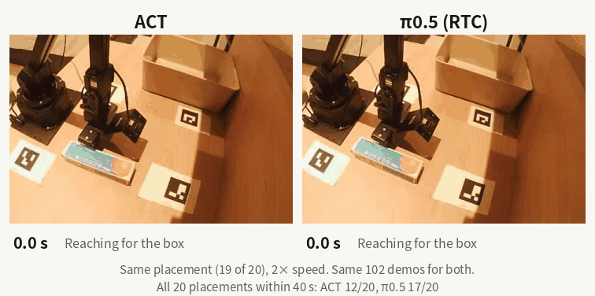

# nexarm-imitation

在 NexArm 主从臂上做模仿学习：用遥操作采集"抓药盒放进收纳盒"的示教数据，训练 ACT、微调 π0.5，
在真机上用同样的条件评测两者的成功率和推理延迟。

20 个固定位置里的第 19 个，左边 ACT、右边 π0.5（RTC 异步推理），两个都用同样的 102 条示范，2 倍速，秒数是真实时间。
这个位置只有 π0.5 成功。这样的位置一共 5 个：第 15 个 ACT 那次的录像里有操作者的手，没用；其余 3 个 π0.5 要 25–33 秒才放进。
所以这是对 π0.5 比较有利的一个例子。20 个位置 40 秒内 ACT 12/20、π0.5 17/20。
约 50 秒的完整演示视频（两个模型同位置对比、随机摆放、失败的例子、结果）用 `scripts/make_demo.py` 从评测录像生成。

接在项目一 [nexarm-teleop-latency](https://github.com/lfulai223-wq/nexarm-teleop-latency) 后面：
遥操作链路、串口驱动和延迟测量方法都来自那里。

**状态：** 两批共录 109 条示范（可用 102 条）。ACT 用 45 条和 102 条各训练一个，同一天在 20 个固定位置交替评测：40 秒内成功 8/20 和 12/20（25 秒内 6 和 11），多出来的成功全在第二批补录的横放上。π0.5 用同样的 102 条在本机做 LoRA 微调，同一场评测里 40 秒内成功 17/20，102 条的 ACT 12/20（p = 0.18，20 个位置还不显著），差别全在横放；代价是每次重新预测 245 ms（ACT 9 ms），同步推理时每 2 秒停顿一次。换成 RTC 异步推理后同样 17/20，不再停顿，成功时松手中位数 9.9 秒（同步 15.3、ACT 12.2）。不用位置表、随机平放 15 次成功 12 次（位置和角度都在训练数据覆盖的范围内）；旁边加了别的盒子或者药盒立着放时都没夹起来。
计划和进度见 [docs/roadmap.md](docs/roadmap.md)。

## 环境

- 录制和训练用商家改版的 LeRobot（`nexarm_follower` / `nexarm_leader`），在它的虚拟环境里运行，
  并装上项目一的包：`pip install -e ~/nexarm-teleop-latency`。
- `scripts/make_print_sheets.py` 需要 matplotlib（项目一的环境里有）。

## 文件

| 文件 | 用途 |
|---|---|
| `configs/record_pilot.yaml` | 试录 10 条的 LeRobot 录制配置，开头写了用法、按键和收尾方法 |
| `configs/record_formal.yaml` | 正式录制配置，每批 50 条，第二批用 `--resume=true` 接着录 |
| `configs/teleop_practice.yaml` | 录之前练手：只遥操作不录数据，控制频率和录制时一样 |
| `configs/rollout_base.yaml` | 在真机上跑训练好的策略（`lerobot-rollout`），跑完回到起始姿势 |
| `docs/recording_guide.md` | 录制操作步骤：每一步按什么键、听到什么语音、出意外怎么办 |
| `scripts/check_setup.py` | 开工检查：设备、相机帧率和亮度、ArUco 码有没有偏、从臂读舵机是否正常、主从姿势差 |
| `scripts/eval_trials.py` | 真机评测：20 个固定摆放逐次试抓，键盘记成功失败，每次录像，结果写进 CSV；两个模型对比时每个位置两个模型交替各测一次；`--free N` 不用位置表、操作者随机摆 |
| `scripts/eval_stages.py` | 评测结果按关节数据逐次分析（什么时候夹住、什么时候松手），算限定秒数内的成功，两个模型逐个位置配对比较 |
| `scripts/placement_coverage.py` | 用第一次合上夹爪时的关节读数量每次夹取的位置和朝向，和训练示范比，看评测时的摆放训练时见过没有 |
| `scripts/make_demo.py` | 从评测录像剪演示视频（`outputs/demo/demo.mp4`）和 README 动图（`docs/img/demo.gif`），按每帧实际时间播放，支架相机裁掉房间 |
| `scripts/record_safe.py` | `lerobot-record` 外面包一层：同样的从臂读数保护，加上多按的 → 和空的一条不会让录制崩溃；第二批起录制一律用它 |
| `scripts/record_prompter.py` | 录制时跟着日志用语音报下一条摆在哪里、什么方向 |
| `scripts/pi05_train_memory.py` | π0.5 各种微调方式在本机显卡上的峰值显存和每步耗时（合成输入，和 lerobot-train 一样的一步更新） |
| `scripts/pi05_infer_latency.py` | π0.5 预测一个动作块要多久、占多少显存 |
| `scripts/train_pi05.py` | 从 `lerobot/pi05_base` 微调 π0.5：lerobot-train 加一处步骤名兼容，参数和 lerobot-train 一样 |
| `scripts/rollout_safe.py` | `lerobot-rollout` 外面包一层从臂读数保护（连上后的第一次读数经常是坏的），上真机一律用它 |
| `scripts/align_camera.py` | 支架相机被碰歪后，语音报和基准差几个像素，边听边调回去 |
| `scripts/make_print_sheets.py` | 生成 ArUco 码和标定棋盘格的 A4 打印文件 |
